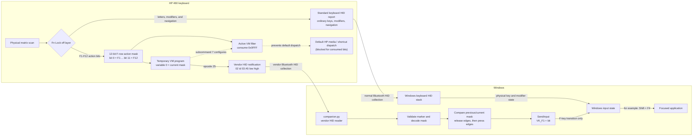

# HP 460 Keyboard Remapper

A standard-library-only Windows companion that makes the **HP 460 Multi-Device
Bluetooth Keyboard** (`VID 03F0`, `PID 814A`) behave like a normal keyboard.

The helper provides:

- F1–F12 without holding Fn, including Shift/Ctrl/Alt combinations;
- native Print Screen, Insert, Delete, Home, End, Page Up, and Page Down;
- no driver, firmware modification, hardware modification, or administrator
  installation.

Media actions on the primary layer are intentionally discarded.

## How it works

Fn Lock off gives the keyboard's navigation cluster its normal HID usages, but
normally leaves F1–F12 on HP's media and shortcut layer. The companion loads a
temporary program into the keyboard's built-in programmable-key VM. That
program consumes all twelve F-row action bits, preventing their default
dispatch, and publishes the combined 12-bit key mask through the vendor HID
notification interface.



The keyboard therefore exposes two parallel paths. Ordinary keys, physical
modifiers, and the navigation cluster stay on the standard keyboard HID path.
Only the consumed F-row mask travels through the vendor path and the companion;
the two paths meet in Windows input state immediately before the application.

Internally, VM subcommand 7 installs the consumed-key mask `0x0007FF80`.
The firmware's active filter shifts that value right by seven, producing
`0x0FFF`: one bit for each key from F1 through F12. VM variable 0 contains the
current special-key state, and opcode 25 publishes it in a six-byte payload:

```text
02 <button-id> 03 A5 <mask-low> <mask-high>
```

For example, F1 plus F4 is mask `0x009`, so the notification ends in
`09 00`. The `A5` byte is a private marker that lets the companion reject
unrelated vendor traffic.

The companion tracks changes in that mask and sends only the corresponding
F-key down/up transitions through Windows `SendInput`. It does not synthesize
or replace modifier state: Shift, Ctrl, and Alt continue to come from the
keyboard's ordinary physical report. Consequently, combinations such as
Shift+F4 remain intact instead of becoming the zero-modifier F4 report produced
by HP's normal programmable-key remapping.

The host-side state machine is essentially:

```python
mask = int.from_bytes(payload[4:6], "little") & 0xFFF
released = previous & ~mask
pressed = mask & ~previous

for bit in range(12):
    if released & (1 << bit):
        inject_key(0x70 + bit, down=False)  # VK_F1 is 0x70
for bit in range(12):
    if pressed & (1 << bit):
        inject_key(0x70 + bit, down=True)

previous = mask
```

Only the F-key transition is injected. A physically held modifier has already
reached Windows through the keyboard's normal HID report, so Windows naturally
combines it with the injected F-key.

The VM program is deliberately bounded and is refreshed while the companion is
healthy. Each instance emits at most 127 notifications; the helper refreshes it
once per second and reconnects if valid notifications disappear for three
seconds. If the helper stops, the remaining VM iterations expire and release
the F-row rather than leaving the keyboard permanently captured.

## Requirements

- Windows 10 or 11
- Python 3.10 or newer
- An HP 460 keyboard paired over Bluetooth
- No third-party Python packages

## Run

```powershell
PYTHON.EXE companion.py
```

Keep the terminal open while using the keyboard. The helper automatically:

1. closes HP Accessory Center because it occupies the control interface;
2. sets current and startup Fn Lock off;
3. clears the twelve stored F-key programs;
4. loads the temporary mask program and reconnects when necessary.

Only one copy can run in a Windows login session. A second launch exits after
reporting that the companion is already running. On a normal exit, read error,
silent notification stream, or reconnect, the helper releases any synthetic
F-keys that it still holds.

Run it without a console window with:

```powershell
PYTHONW.EXE companion.py
```

To start it automatically at login, open `shell:startup` from the Windows Run
dialog and place a shortcut there with a target like:

```text
"C:\Path\To\pythonw.exe" "C:\Path\To\hp-460-keyboard-remapper\companion.py"
```

Background diagnostics are written to
`%LOCALAPPDATA%\HP460Companion\companion.log`. The log rotates automatically.

F1–F12 require the running helper. The navigation cluster remains native after
the helper exits because Fn Lock is stored off.

## Diagnostics and limits

To observe the decoded F-row stream without injecting keys:

```powershell
PYTHON.EXE companion.py --observe --seconds 20
```

Useful options:

- `--device-index N` selects a keyboard when more than one is connected.
- `--no-kill-hpac` leaves HP Accessory Center open, although it will usually
  prevent the companion from opening the control interface.
- `--reconnect-seconds N` changes the retry interval.

The vendor mask stream is sampled at roughly 23 Hz, so exceptionally short
F-key taps may be missed. SendInput is also subject to normal Windows
integrity-level restrictions. The firmware supports only one running temporary
program, and HP Accessory Center cannot use that interface at the same time.

The helper modifies keyboard configuration but never writes firmware and never
disables or restarts a Plug and Play device.

## Protocol research and earlier approaches

- [Historical companion design and key-mask VM program](docs/software-only-plan.md)
- [Protocol and programmable-button records](docs/protocol.md)
- [Reverse-engineering notes](docs/reverse-engineering.md)
- [Firmware structure](docs/firmware.md)
- [Firmware patch and hardware alternatives](docs/current-plan.md)
- [Native-mode flag investigation](docs/native-mode-and-nuclear-options.md)
- [VM interpreter call and the physical-modifier question](docs/vm-interpreter-call.md)

The repository retains the offline emulators, firmware analysis, captures, and
rejected AutoHotkey/firmware approaches for reproducibility. They are not
needed to run the companion.

## Tested configuration

- HP codename: `Ash`
- `VID 03F0`, `PID 814A`
- reported device version: `04B0`
- firmware text version: `1.20.0` / `1200`
- HP Accessory Center: `2.21.4522.0`

Firmware and HPAC binaries are not redistributed. Captures in this repository
are sanitized.

## License

MIT
