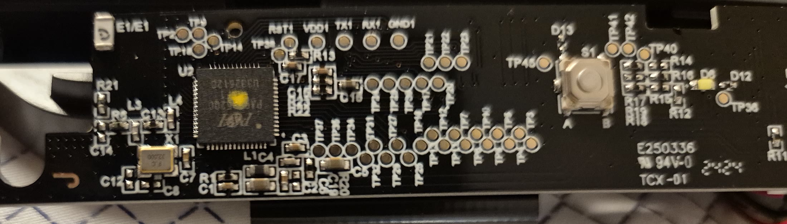
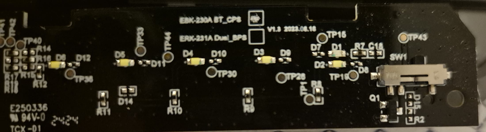

# Board photographs and opening status

The software investigation was followed by an owner-performed visual hardware
inspection on 2026-11-02. No electrical probing, soldering or firmware write
was performed. The inspection is evidence for future hardware research, not a
validated modification procedure.

The Sunrex FCC filing for regulatory model TPA-S001K / FCC ID J75TPAS001K
contains manufacturer-submitted photographs. Its user manual names both HP
460 (Bluetooth) and HP 475 (Bluetooth plus dongle). Confirm the regulatory
model on the actual keyboard before assuming the same case revision.

Sources:

- [Original user manual, mirrored PDF](https://fccid.io/J75TPAS001K/Users-Manual/User-Manual-6609768.pdf)
- [Manufacturer internal photographs](https://fccid.io/J75TPAS001K/Internal-Photos/EUT-Internal-Photo-6609752.pdf)
- [Manufacturer external photographs](https://fccid.io/J75TPAS001K/External-Photos/EUT-External-Photo-6609751.pdf)
- [Filing and exhibit index](https://fcc.report/FCC-ID/J75TPAS001K)

The internal photos provide both PCB sides, a controller close-up and the
opened enclosure. They allow more research before asking the user to open the
keyboard. The PCB has E3K-230A BT / E3K-231A Dual silkscreen; the controller
is PixArt, but paint obscures part of its marking. Do not choose a programmer
or exact pinout from a guessed part number.

Local PDF copies and extracted original JPEGs are under the Git-ignored
`local-research/fcc-tpa-s001k/`. No images were altered or redistributed in Git.

## Owner-supplied PCB evidence

The device owner opened the keyboard and supplied photographs of the component
side. The repository contains only tight PCB crops; the original phone photos,
surroundings, keyboard label and image metadata are not published. The crops
are included with the device owner's permission.

The photographs establish the following facts:

- The PCB is revision `V1.3 2023.08.16` and is marked `TCX-01`.
- The `E3K-230A BT_GP8` selection box has an inspection-paint mark, while
  `E3K-231A Dual_GP8` is unmarked. These are assembly-identification marks,
  not electrical jumpers.
- U2 is the same 64-pin controller family shown in the FCC filing. Its visible
  marking, the FCC close-up and the firmware's own `PAR2801` identification are
  mutually consistent with a PAR2801-family controller. Paint still obscures
  part of the package suffix, so the related PAR2801-Q32P module manual must not
  be treated as the exact package pinout.
- Factory pads labelled `RST1`, `VDD1`, `TX1`, `RX1` and `GND1` are exposed.
  Their labels are consistent with reset, power and UART service signals; they
  do not by themselves prove a bootloader, debug access or arbitrary memory
  access. No pad is visibly labelled SWD.
- Numerous test pads and unpopulated resistor footprints are visible. No
  labelled jumper or visually safe bridge for native mode has been identified.

The shared BT/Dual board and its explicit assembly selection strengthen the
hardware-configuration-strap hypothesis. They do not map logical GPIO `0x21`
to a physical package pin, PCB net or resistor. Hidden/internal PCB traces also
cannot be recovered from photographs alone.

### Publication boundary

Safe repository evidence consists of the sanitized crops above and generated
validation summaries under `captures/`. Proprietary firmware, HP application
disassembly, unsanitized live-device captures, third-party PDFs/datasheets and
the uncropped owner photographs remain under ignored local research storage.
Public FCC exhibits are linked above instead of being copied into the
repository.

## What is visible in the FCC exhibits

- External PDF page 1: underside, folding rear feet, rubber pads and long label.
- Internal PDF page 1: removed battery cover, battery compartment and raised
  folding foot with a round recessed opening beneath it.
- Internal PDF page 2: separated shells remain connected by battery wires.
  The PCB is already accessible without removing the large metal keyboard plate.
- Internal PDF pages 3 and 4: PCB views and controller close-up.

These are photographs of an already opened unit, not a screw-removal guide.
They do not establish every hidden screw location, screw count, driver size,
or the correct clip-release direction. No complete opening procedure has
been verified. In particular, do not assume the round recess beneath a
folding foot contains a screw without inspecting the actual unit.

## First inspection before prying

1. Switch off, remove the battery cover and both AAA batteries.
2. Raise both folding feet. Photograph the whole underside, empty battery
   compartment and recesses under those feet; keep unique labels private.
3. Inspect recesses for actual screw heads. Gently lifting a rubber pad edge
   to check for hidden screws is a general repair technique, not a confirmed
   screw map for this keyboard. Avoid peeling the long label until needed.
4. Use a fitting small screwdriver only on confirmed screw heads. Once the
   fasteners are identified and removed, a plastic opening pick may be used
   at the case seam. Do not force a locally anchored section or pull shells
   apart abruptly: the manufacturer photo shows short battery wires between
   the halves. Do not remove keycaps or the metal plate for initial PCB access.

If a hardware phase is explicitly resumed, a user photograph should establish
the fasteners before model-specific prying instructions are given. Existing
FCC photos can support research without opening the user's keyboard.
